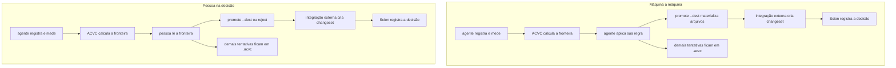

# ACVC: memória de hipóteses para trabalho experimental em código

Para quem ainda não conhece o ACVC: um agente produz tentativas, mede resultados
e abandona caminhos. O ACVC preserva essa exploração fora do histórico Git.
`acvc promote --dest` materializa os arquivos escolhidos; `--git` também cria um
commit no checkout indicado.

## Resumo

Agentes de código exploram alternativas, voltam atrás e modificam hipóteses
durante uma sessão. O Git registra estados que alguém decidiu conservar, mas um
commit não informa quais alternativas ainda competiam, como foram medidas ou
por que uma delas foi abandonada [1, 2, 4].

O ACVC registra esse processo como uma campanha de hipóteses. Cada hipótese
combina uma premissa, seus pressupostos, uma intenção, sua relação com os pais e
uma árvore de arquivos. Ensaios acrescentam medições sem alterar sua identidade.
A fronteira mantém as medições completas que não foram dominadas; uma rejeição
permanece um ato separado e exige motivo explícito.

O armazenamento é local e endereçado por conteúdo. Árvores de Merkle evitam
gravar novamente arquivos idênticos [12], enquanto o Git continua responsável
pela variante que será conservada. A regra da fronteira possui um modelo
TLA+/TLC no repositório. Esta descrição não apresenta estudo com usuários nem
avaliação de escala em grandes monorepositórios.

## 1. Problema e escopo

### 1.1 O que o commit não registra

Um agente pode produzir muitas versões antes de chegar a uma mudança útil. Se
cada tentativa vira commit, o histórico da decisão se mistura ao histórico da
exploração. Se apenas a tentativa escolhida vira commit, desaparecem a premissa
das demais, suas medições e o motivo do abandono. Estudos sobre programação
exploratória e notebooks descrevem formas semelhantes de desordem [5–7].

O problema tratado pelo ACVC não é recuperar uma versão antiga. É preservar a
relação entre uma afirmação sobre o código, os arquivos que a materializam e a
evidência usada para compará-la com outras afirmações.

### 1.2 A pergunta do sistema

Depois de várias tentativas, quais hipóteses ainda competem e por quê? A resposta
precisa sobreviver à sessão que produziu as tentativas, sem transformar o Git
num diário de experimentos.

### 1.3 Limite de responsabilidade

O ACVC não executa testes, não cria ambientes isolados, não faz merge e não
substitui o Git. Ele recebe arquivos e medições produzidos por ferramentas
externas. Quando uma hipótese é escolhida, `promote` materializa seus arquivos
num destino ou cria um commit numa worktree Git, conforme o modo solicitado.

## 2. Modelo conceitual

Uma **campanha** representa uma pergunta comparável. Ela declara previamente as
métricas e a direção de cada uma: `higher` quando valores maiores são melhores,
`lower` quando valores menores são melhores.

Uma **hipótese** reúne:

- premissa e pressupostos escritos em linguagem humana;
- intenção do experimento e identidade do agente;
- árvore de arquivos;
- pais e relação com esses pais.

As relações são `seed`, `mutate`, `revert`, `revise_premise` e `synthesize`.
Uma campanha possui uma origem. Uma mutação parte da hipótese corrente ou de um
pai informado; uma revisão referencia pelo hash a hipótese cuja premissa está
sendo revista; uma síntese tem dois ou mais pais. Como a relação entra na
identidade, uma mutação e uma revisão da mesma árvore continuam sendo hipóteses
distintas.

Um **ensaio** mede uma hipótese. Pode ser completo ou incompleto e não participa
da identidade da hipótese. Um novo ensaio não apaga os anteriores.

Uma **rejeição** registra uma decisão e seu motivo. Ela não decorre
automaticamente de uma medição pior. Essa separação impede que o sistema invente
uma justificativa que ninguém forneceu.

## 3. Semântica da fronteira

Uma medição só entra na fronteira quando contém todas as métricas declaradas.
Medições incompletas continuam no histórico, mas não participam da comparação.

Uma medição domina outra quando não é pior em nenhuma métrica e é melhor em pelo
menos uma [8, 16, 17]. A fronteira contém todas as medições completas que
nenhuma outra domina. Duas alternativas podem permanecer simultaneamente: uma
pode ser mais rápida enquanto a outra é mais precisa. Métricas de ensaios
diferentes nunca são combinadas para produzir uma pontuação fictícia.

Dentro da mesma hipótese, um ensaio completo estritamente pior deixa de ser seu
representante. Na campanha, permanecem todos os representantes não dominados.

O estado JSON usa quatro valores estáveis:

- `on_frontier`: existe uma medição completa não dominada;
- `superseded`: outra hipótese apresenta uma medição dominante;
- `rejected`: alguém registrou explicitamente o encerramento e seu motivo;
- `unmeasured`: ainda não existe ensaio completo.

Sair da fronteira não equivale a morrer. Sem rejeição, a leitura pode mostrar
quem venceu e em qual métrica, mas deve declarar que o motivo não foi registrado.

## 4. Identidade e armazenamento

### 4.1 Controle por hash

O Git guarda blobs, árvores e commits endereçados pelo conteúdo [1, 2]. Uma
árvore referencia hashes; não contém novamente os bytes de cada arquivo. O ACVC
aplica o mesmo princípio a hipóteses, usando BLAKE3 [3].

A identidade de uma hipótese é o hash de uma representação canônica que inclui
árvore, pais, relação, premissa, pressupostos, revisão, intenção e agente. Nome
da campanha, data, medições, consumo de tokens e caminho do workspace ficam fora
desse hash. Assim, pontuar uma hipótese não cria outra hipótese.

### 4.2 Árvores e escrita incremental

Os arquivos formam uma árvore de Merkle [12]. Um arquivo entra como blob; um
diretório referencia nomes, modos, tipos e hashes. Na gravação, um caminho limpo
reutiliza seu hash. Apenas caminhos novos ou alterados exigem leitura e novo
blob. Subárvores idênticas podem ser comparadas pelo hash.

O armazenamento fica em `.acvc/`. Na escrita normal, blobs e árvores novos são
anexados a `objects.log`. `pack` move blobs frios para `objects.pack` e reescreve
o log quente; árvores permanecem no log. O SQLite guarda campanhas, variantes,
pais, ensaios, rejeições, gastos e o índice textual FTS5 [13]. Interfaces não
devem abrir esses arquivos diretamente; o contrato público é o executável.

A varredura ignora diretórios fixos, como `.git`, `.acvc`, `target` e
`node_modules`, e aceita exclusões em `.acvcignore`. O `.gitignore` não define a
identidade de uma hipótese.

## 5. Fluxo operacional

Uma sessão começa com leitura:

1. `context` apresenta a campanha e suas relações;
2. `frontier` mostra o que ainda compete;
3. `why`, `recall`, `compare` e `file-diff` explicam hipóteses existentes.

Quando a campanha não existe, o usuário declara as métricas e registra a origem
com `seed`. Depois de alterar arquivos, usa `record` para criar uma hipótese
ligada ao pai. `score` acrescenta uma medição real; `reject` encerra uma hipótese
somente quando existe um motivo conhecido.

O consumo de tokens é um livro-caixa lateral feito por `spend`. Ele não é
métrica, orçamento ou parte da identidade e deve ser observado, não estimado.

Ao final, `promote --dest` materializa os arquivos da hipótese numa pasta.
`promote --git` exige uma worktree Git, materializa e adiciona esses arquivos e
cria um commit. Nenhum dos modos limpa o destino ou remove caminhos ausentes da
hipótese. A operação não faz merge nem reescreve o histórico de hipóteses.

## 6. Interfaces e fonte de verdade

A CLI define o contrato do produto. A saída padrão é JSON; `--format text`
produz frases para pessoas. Os valores de estado permanecem estáveis entre
idiomas.

O servidor MCP e a página web delegam comandos ao executável corrente; os
visores de editor executam o binário configurado. A TUI chama diretamente o
mesmo núcleo de aplicação. Essas interfaces não mantêm outra implementação de
identidade, fronteira ou armazenamento.

Quando documentação e executável discordarem, o executável é a autoridade
comportamental. `acvc assistant` expõe o contrato operacional instalado.

## 7. Evidência disponível

O repositório contém um modelo TLA+/TLC para a regra da fronteira. Essa evidência
se limita às propriedades do modelo nos estados explorados; não demonstra
usabilidade, adoção ou desempenho industrial.

Os exemplos exercitam campanhas com uma e várias métricas, medições
incomparáveis, rejeição e promoção. Demonstram o fluxo esperado, mas não
constituem estudo controlado.

| Afirmação | Evidência disponível | Não estabelecido |
| --- | --- | --- |
| A fronteira preserva alternativas não dominadas | Modelo TLA+/TLC e testes | Compreensão por usuários novos |
| A identidade é estável para o mesmo conteúdo canônico | Definição e implementação | Desempenho em repositórios extremos |
| Interfaces compartilham o executável | Arquitetura declarada | Ausência futura de divergência |
| Hipóteses ajudam a próxima sessão | Casos de uso do projeto | Ganho em estudo longitudinal |

## 8. Relação com outros sistemas

Os sistemas abaixo atuam em etapas vizinhas e podem parecer substitutos. A
comparação delimita responsabilidades: controlar versões, isolar execuções e
rastrear experimentos não equivalem a preservar hipóteses concorrentes.

| Projeto | O que guarda | Onde para, em relação ao ACVC |
| --- | --- | --- |
| Git [1, 2] | Blobs, árvores e commits endereçados por conteúdo | O commit registra uma decisão; hipóteses abandonadas não formam uma fronteira. |
| Gitless [4] | Camada conceitual sobre o Git | Reorganiza conceitos do Git, sem premissas ou ensaios. |
| container-use [11] | Container, worktree e branch por agente, com comandos em Git notes | Isola execução; não pontua hipóteses. |
| Scion [25] | Changesets e blobs endereçados por conteúdo num servidor para monorepo | Barateia histórico e checkout; não mantém uma fronteira de hipóteses medidas. |
| Variolite [5] | Variantes leves dentro do editor | Explora trechos, sem campanha Merkle ou fronteira. |
| DVC [19] | Dados, modelos e pipelines sobre o Git | A execução do pipeline é central; não há aresta de hipótese nem fronteira de código. |
| MLflow [9] | Parâmetros, métricas e artefatos de execuções | A execução é central; a árvore não é uma hipótese Merkle. |
| Sacred [10] | Configuração, fonte e resultados | Registra execução, sem revisão de premissa ou fronteira. |
| Weights & Biases [20] | Experimentos e gráficos hospedados | Rastreia execuções, não um hash local de hipótese. |
| Jupyter [21] | Notebook narrativo e saídas | Não compartilha subárvores por hash entre alternativas. |
| Unison [22] | Definições de linguagem endereçadas por conteúdo | O hash nomeia uma definição, não uma hipótese medida. |
| Nix [23] | Builds reproduzíveis por derivação | O hash controla build, não premissa e fronteira. |
| Jujutsu [24] | Controle de versão compatível com Git | Mantém uma história de mudanças, não uma campanha experimental. |
| Linhas de produto [18] | Variantes de features | Uma feature não é hipótese sob um esquema de métricas. |

### 8.1 Scion e ACVC: da exploração ao histórico

O [Scion](https://www.anthropic.com/engineering/redesigning-source-control) é um sistema interno da Anthropic para um monorepo grande e uma carga elevada de
mudanças produzidas por agentes [25]. Seu modelo cliente-servidor trata
changesets, consultas e checkouts esparsos. Os números publicados — inclusive
30.401 merges em 9 de setembro de 2026, histórico de quase 100 GB e `status` de
19 ms — pertencem ao relato da Anthropic; este repositório não os mediu.

O Scion aparece porque também discute source control para agentes e conteúdo por
hash. O objeto central, porém, é outro: o Scion administra changesets do
monorepo; o ACVC administra hipóteses experimentais, medições e rejeições. Essa
diferença permite uma composição em vez de uma escolha entre produtos.

O ACVC pode ocupar o plano de exploração. Agentes registram alternativas,
acrescentam ensaios e mantêm fora do histórico principal as hipóteses ainda não
escolhidas. A fronteira reduz o conjunto que exige decisão sem apagar resultados
dominados ou rejeitados. O Scion pode ocupar o plano de integração: depois da
escolha, recebe o changeset, sustenta consultas históricas, blame, checkouts
esparsos e o volume de leitura do monorepo.

O valor conjunto está nessa passagem. O ACVC preserva a evidência que explica
por que uma mudança foi escolhida; o Scion torna barata a operação sobre o
histórico que recebeu essa mudança. Quando várias tentativas iriam para `main`,
o ACVC pode evitar que a exploração inteira vire histórico. Quando uma tentativa
já é a decisão, ela pode seguir diretamente ao source control. Em ambos os
casos, o Scion resolve escala de repositório sem precisar decidir qual hipótese
venceu, e o ACVC organiza a decisão sem precisar resolver checkout ou blame em
escala extrema.

Essa composição ainda é arquitetural, não uma integração entregue por este
repositório. O ACVC atual sabe materializar arquivos e criar commits Git; não há
cliente Scion. Um uso conjunto precisa de uma camada externa que transforme a
hipótese promovida em changeset do Scion. A seção 8.4 mostra onde essa passagem
entra no fluxo e quais responsabilidades permanecem separadas.

### 8.2 container-use: isolamento de execuções

O [container-use](https://github.com/dagger/container-use) é um servidor MCP e
uma CLI baseada em Dagger [11]. Ele cria um ambiente isolado por agente, com
container e branch Git, e registra comandos da execução. Seu objetivo é evitar
colisão entre trabalhos paralelos.

Ele responde onde a execução ocorreu, quais comandos rodaram e quais arquivos
mudaram. O ACVC responde o que a tentativa afirmava, como foi medida e se ainda
pertence à fronteira. Um fluxo pode usar container-use na execução e ACVC na
memória comparável entre execuções.

### 8.3 Rastreadores, notebooks e proveniência

MLflow, Sacred, DVC e Weights & Biases associam execuções a parâmetros, dados,
artefatos ou métricas [9, 10, 19, 20]. Notebooks preservam código, narrativa e
saídas [6, 7, 21]. O W3C PROV oferece um modelo geral de entidades, atividades e
agentes [15]. O recorte do ACVC é estreito: liga uma premissa humana a uma árvore
de código, à sua linhagem e a uma comparação multiobjetivo.

### 8.4 Fluxo da composição

O ACVC fica antes da entrada no histórico. A fronteira informa a escolha;
`promote` não escolhe a hipótese. Conforme o modo, ele materializa seus arquivos
ou cria um commit Git. A autorização e a regra de escolha pertencem a quem chama
o comando, seja uma pessoa, um script ou um agente. Num ambiente com Scion, uma
camada externa converte a saída promovida em changeset; essa última etapa não é
implementada pelo ACVC atual.

| | Só o Scion | Só o ACVC | Os dois juntos |
| --- | --- | --- | --- |
| Pergunta | Quem mudou uma linha e o que entrou no histórico? | Quais medições completas ainda competem? | O Scion responde pelo histórico; o ACVC, pela busca anterior. |
| Tentativa não promovida | O post não define um repositório experimental separado. | Fica em `.acvc`, com medições. | Fica em `.acvc`; uma integração externa envia ao Scion apenas a decisão promovida. |
| Ganho da composição | Histórico e checkout escaláveis. | Seleção explicável entre hipóteses medidas. | A decisão conserva sua evidência sem transferir toda a exploração ao histórico operacional. |
| Fora do escopo | Escolher entre tentativas medidas. | Checkout e blame de monorepo extremo. | A escolha continua externa; o custo do checkout continua com o Scion. |

## 9. Limitações

### 9.1 Validade dos registros

O sistema não verifica a honestidade de uma premissa nem se a métrica representa
o objetivo real. Uma medição completa pode ser irrelevante. A fronteira organiza
a evidência fornecida; não garante sua qualidade.

### 9.2 Execução e isolamento

O ACVC não executa código, captura automaticamente o ambiente ou isola
processos. Shells, containers e CI continuam responsáveis por isso.

### 9.3 Portabilidade e escala

O modelo atual de identidade usa metadados Unix; Windows está fora do escopo
documentado. Também não há avaliação para checkouts de centenas de gigabytes ou
dezenas de milhões de operações. Cache não transforma uma campanha em sistema
de source control para monorepos.

### 9.4 Evolução do contrato

Software e descrição podem divergir. O executável instalado e `acvc assistant`
devem ser consultados antes de operar ou explicar o produto.

## 10. Conclusão

O ACVC preserva uma parte da exploração que o commit escolhido não contém: a
premissa de cada alternativa, sua árvore, linhagem, medições e o motivo de uma
rejeição. A fronteira mantém mais de uma alternativa quando objetivos entram em
conflito, sem transformar dominância em decisão.

O Git continua responsável pela mudança conservada. O ACVC permanece ao lado
dele como memória experimental local. A contribuição central não é outro merge,
mas um objeto explícito para a hipótese que antecede o commit.

## Referências

[1] S. Chacon and B. Straub, *Pro Git*, 2nd ed. Apress, 2014. "Git Internals — Git Objects." https://git-scm.com/book/en/v2/Git-Internals-Git-Objects

[2] L. Torvalds e os contribuidores do Git, Git, 2005–. https://git-scm.com/

[3] J. O'Connor, J.-P. Aumasson, S. Neves, and Z. Wilcox-O'Hearn, "BLAKE3: one function, fast everywhere," 2020. https://github.com/BLAKE3-team/BLAKE3-specs/blob/master/blake3.pdf

[4] S. Perez De Rosso and D. Jackson, "Purposes, concepts, misfits, and a redesign of Git," in *Proc. OOPSLA 2016*, pp. 292–310. doi: 10.1145/2983990.2984018

[5] M. B. Kery, A. Horvath, and B. A. Myers, "Variolite: Supporting exploratory programming by data scientists," in *Proc. CHI 2017*, pp. 1265–1276. doi: 10.1145/3025453.3025626

[6] A. Rule, A. Tabard, and J. D. Hollan, "Exploration and explanation in computational notebooks," in *Proc. CHI 2018*, paper 32. doi: 10.1145/3173574.3173606

[7] A. Head, F. Hohman, T. Barik, S. M. Drucker, and R. DeLine, "Managing messes in computational notebooks," in *Proc. CHI 2019*, paper 270. doi: 10.1145/3290605.3300500

[8] H. T. Kung, F. Luccio, and F. P. Preparata, "On finding the maxima of a set of vectors," *Journal of the ACM*, vol. 22, no. 4, pp. 469–476, 1975. doi: 10.1145/321906.321910

[9] M. Zaharia et al., "Accelerating the machine learning lifecycle with MLflow," *IEEE Data Engineering Bulletin*, vol. 41, no. 4, pp. 39–45, 2018.

[10] K. Greff, A. Klein, M. Chovanec, F. Hutter, and J. Schmidhuber, "The Sacred infrastructure for computational research," in *Proc. SciPy 2017*, pp. 49–56. doi: 10.25080/shinma-7f4c6e7-008

[11] Contribuidores do Dagger, container-use, 2025–. https://github.com/dagger/container-use

[12] R. C. Merkle, "A digital signature based on a conventional encryption function," in *Advances in Cryptology — CRYPTO '87*, LNCS 293, Springer, 1988, pp. 369–378. doi: 10.1007/3-540-48184-2_32

[13] D. R. Hipp, "SQLite FTS5 extension." https://www.sqlite.org/fts5.html

[14] K. R. Popper, *The Logic of Scientific Discovery*. Hutchinson, 1959. Tradução inglesa de *Logik der Forschung*, 1934.

[15] L. Moreau, P. Missier, et al., "PROV-DM: The PROV data model," W3C Recommendation, 30 April 2013. https://www.w3.org/TR/prov-dm/

[16] V. Pareto, *Manuale di economia politica*. Società Editrice Libraria, 1906.

[17] K. Deb, *Multi-Objective Optimization Using Evolutionary Algorithms*. Wiley, 2001.

[18] S. Apel, D. Batory, C. Kästner, and G. Saake, *Feature-Oriented Software Product Lines*. Springer, 2013.

[19] Iterative, DVC: Data Version Control. https://dvc.org

[20] Weights & Biases. https://wandb.ai

[21] T. Kluyver et al., "Jupyter notebooks — a publishing format for reproducible computational workflows," in *Positioning and Power in Academic Publishing: Players, Agents and Agendas*, IOS Press, 2016, pp. 87–90. doi: 10.3233/978-1-61499-649-1-87

[22] P. Chiusano and R. Bjarnason, Unison. https://www.unison-lang.org

[23] E. Dolstra, "The purely functional software deployment model," Ph.D. dissertation, Utrecht University, 2006.

[24] M. von Zweigbergk e contribuidores, Jujutsu. https://github.com/jj-vcs/jj

[25] Nick G. e o time de source control da Anthropic, "Redesigning source control at Anthropic," Anthropic Engineering, 13 de outubro de 2026, atualizado em 15 de outubro de 2026. https://www.anthropic.com/engineering/redesigning-source-control
