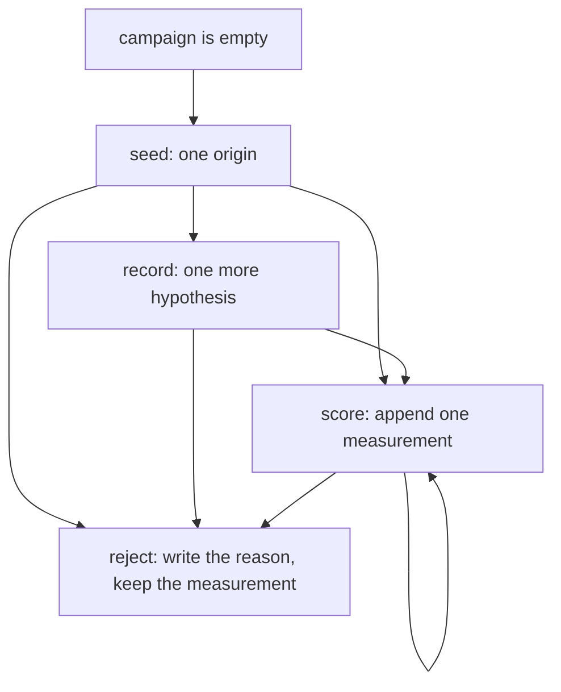
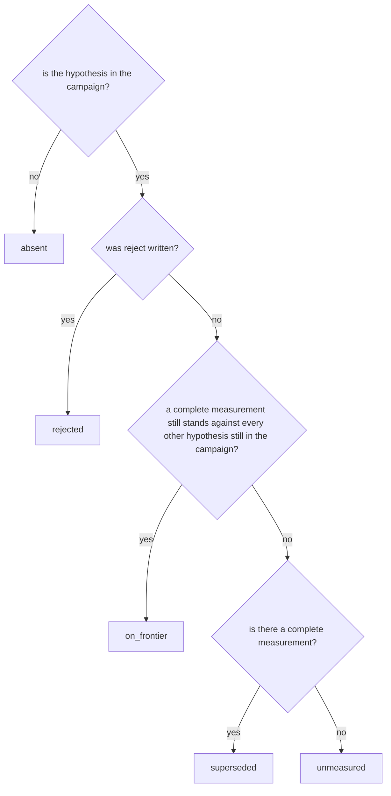

# The frontier, checked with TLC

ACVC keeps the attempts that should not become commits, and shows which of them still compete. This note is the check of that rule. The checker walked a small model of a campaign. It did not run the Rust binary, and it did not look at file hashes, the pack, languages, or the viewers.

The modules are in [specs/frontier](specs/frontier).

## What ran

[TLC](https://lamport.azurewebsites.net/tla/tools.html) 2.19, 08 August 2024, revision `5a47802`, on Java 21. The jar is the TLA+ tools release that ships that TLC. It is not stored in this repository.

From `specs/frontier`:

```bash
java -cp /path/to/tla2tools.jar tlc2.TLC -config AcvcFrontier.cfg AcvcFrontier.tla
```

Each example uses the same command with its own `.cfg` and `.tla`.

On 19 October 2026, one worker, the campaign model finished in 3 seconds: 198,197 states generated, 66,613 distinct, depth 9. TLC reported no error. Each documentation example finished with no error. `ExampleReject` has 4 distinct states and depth 3. The others are a single state.

## The model

Two hypotheses, `a` and `b`. Two numbers: `m1`, where larger is better, and `m2`, where smaller is better. Each number is `0`, `1`, or missing. Missing is the integer `-1`, so TLC can compare values in one set. Each hypothesis receives at most two measurements (`MaxTrials = 2` in [AcvcFrontier.cfg](specs/frontier/AcvcFrontier.cfg)).

The shared operators live in [AcvcRules.tla](specs/frontier/AcvcRules.tla). A measurement dominates another when every number is at least as good and one number is strictly better. A hypothesis offers the complete measurements that are not strictly worse than another measurement of the same hypothesis. A rejected hypothesis offers nothing.

`promote` is outside the model. Materializing files with `--dest` or creating a commit with `--git` does not change who still competes.

## The actions



`seed` runs only while the campaign is empty. The origin does not change after that. `record` adds a hypothesis and leaves the measurements alone. `score` appends. Earlier measurements stay. `reject` adds a reason and does not delete a measurement.

## Who still competes

`absent` exists only inside the model, for a name that has not been recorded yet. The executable reports the other four codes.



A hypothesis can be rejected while it still competes. The reason is a separate act. Losing the comparison writes no reason.

Inside one hypothesis, a complete measurement that is worse on every number drops out of what that hypothesis offers. The hypothesis can stay `on_frontier` because of another measurement. Two hypotheses that tie, or that win on different numbers, both stay `on_frontier`.

## What held in every state

- `TypeOK` — the campaign shape stays inside the bounds above.
- `InvRejectedOff` — a rejected hypothesis is off the frontier.
- `InvIncompleteOff` — a measurement that still represents its hypothesis is complete.
- `InvSameVariantDropsWorse` — a strictly worse measurement of the same hypothesis does not represent it.
- `InvNoSingleWinner` — a tie, or a pair that wins on different numbers, leaves both `on_frontier`.
- `InvDominatedIsSuperseded` — the hypothesis that loses every number to one that is still competing is `superseded`, and the winner stays `on_frontier`.
- `InvRejectedDoesNotDominate` — once every other hypothesis is rejected or unmeasured, the one that remains is `on_frontier`.
- `InvStatus` — `rejected`, `on_frontier`, `superseded`, and `unmeasured` match the definitions above.
- `AppendOnly` — a measurement is never rewritten or removed.
- `OriginOnce` — the origin is chosen once, from empty to one hypothesis.
- `PresentGrows` — hypotheses are added, not removed.
- `RejectGrows` — a written reason stays.

The first model let a rejected hypothesis keep dominating. `Eligible` now returns no measurement when the hypothesis is rejected. The Rust frontier already drops rejected trials before it compares. That run changed the model. It did not change the program.

## The examples in the docs

The numbers are the ones in the README and in `acvc assistant`. Residuals in case A are multiplied by 10^10. Seam and coverage in case B are in hundredths. The order of the numbers is unchanged.

| Module | What the invariant `Ok` holds |
| --- | --- |
| [ExampleIntegral.tla](specs/frontier/ExampleIntegral.tla) | Simpson dominates the trapezoid rule. Simpson and the series both stay `on_frontier`. The singularity, with no measurement, is `unmeasured`. Rejecting the trapezoid rule leaves the other two. |
| [ExampleStitch.tla](specs/frontier/ExampleStitch.tla) | Homography, mesh, and blend all stay `on_frontier`. Blend does not erase mesh. |
| [ExampleOrders.tla](specs/frontier/ExampleOrders.tla) | Postgres and the document store both stay `on_frontier`. Rejecting the document store leaves postgres. The API, with no measurement, stays `unmeasured`. |
| [ExampleSearch.tla](specs/frontier/ExampleSearch.tla) | The seed has no measurement and is `unmeasured`. The next hypothesis, 16 tests and latency 4, is `on_frontier`. |
| [ExampleTwoTrials.tla](specs/frontier/ExampleTwoTrials.tla) | The first two measurements of one hypothesis both stand. The third is worse on both numbers and drops. The hypothesis stays `on_frontier`. |
| [ExampleReject.tla](specs/frontier/ExampleReject.tla) | `reject` sets `rejected`. Spending 15,000 tokens leaves the status unchanged. |
| [ExampleIgnore.tla](specs/frontier/ExampleIgnore.tla) | A blank line and a `#` line are not rules. `lab/reports/out.txt` is skipped. `lab/notes.txt` and `src/lib.rs` stay. `lab/reports-extra` is not skipped. Deleting the rules scans every path again. The set already recorded does not change. |

## Left out

File hashes, the pack, the language of the sentences, the viewers, and anything about a remote. `promote --dest` materializes an approved tree; `--git` also creates a commit. Neither mode moves these states.
