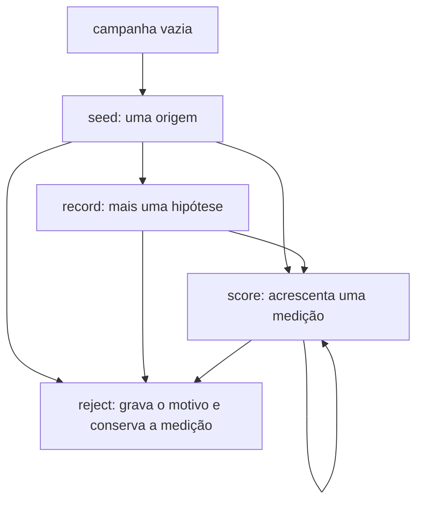
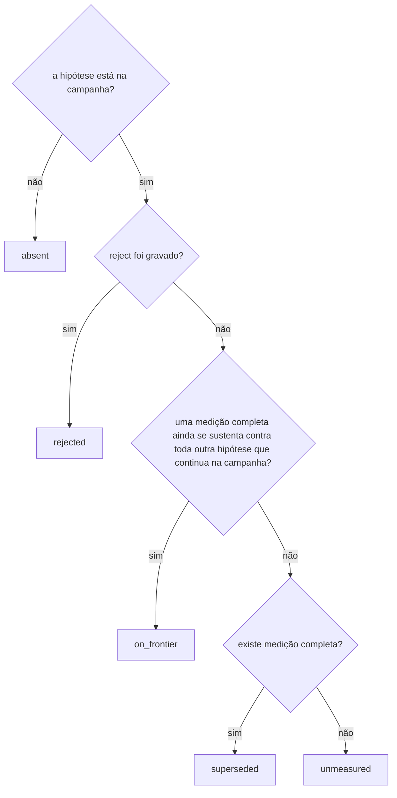

# A fronteira, conferida com o TLC

O ACVC guarda as tentativas que não devem virar commit e mostra quais ainda competem. Esta nota é a conferência dessa regra. O verificador percorreu um modelo pequeno de uma campanha. Ele não executou o binário Rust, e não olhou hash de arquivo, pack, idioma nem visores.

Os módulos estão em [specs/frontier](specs/frontier).

## O que rodou

[TLC](https://lamport.azurewebsites.net/tla/tools.html) 2.19, 8 de agosto de 2024, revisão `5a47802`, em Java 21. O jar é a release das ferramentas TLA+ que traz esse TLC. Ele não está neste repositório.

A partir de `specs/frontier`:

```bash
java -cp /path/to/tla2tools.jar tlc2.TLC -config AcvcFrontier.cfg AcvcFrontier.tla
```

Cada exemplo usa o mesmo comando com o próprio `.cfg` e `.tla`.

Em 19 de outubro de 2026, com um worker, o modelo da campanha terminou em 3 segundos: 198.197 estados gerados, 66.613 distintos, profundidade 9. O TLC não achou erro. Cada exemplo da documentação terminou sem erro. `ExampleReject` tem 4 estados distintos e profundidade 3. Os outros são um estado só.

## O modelo

Duas hipóteses, `a` e `b`. Dois números: `m1`, em que o maior é melhor, e `m2`, em que o menor é melhor. Cada número é `0`, `1` ou está ausente. Ausente é o inteiro `-1`, para o TLC comparar valores num conjunto só. Cada hipótese recebe no máximo duas medições (`MaxTrials = 2` em [AcvcFrontier.cfg](specs/frontier/AcvcFrontier.cfg)).

Os operadores comuns estão em [AcvcRules.tla](specs/frontier/AcvcRules.tla). Uma medição domina outra quando todo número é pelo menos tão bom e um número é estritamente melhor. Uma hipótese oferece as medições completas que não são estritamente piores que outra medição da mesma hipótese. Uma hipótese rejeitada não oferece nada.

`promote` fica fora do modelo. Materializar arquivos com `--dest` ou criar um commit com `--git` não muda quem ainda compete.

## As ações



`seed` só corre com a campanha vazia. A origem não muda depois. `record` acrescenta uma hipótese e deixa as medições quietas. `score` acrescenta. As medições anteriores ficam. `reject` acrescenta um motivo e não apaga medição.

## Quem ainda compete

`absent` existe só dentro do modelo, para um nome que ainda não foi gravado. O executável informa os outros quatro códigos.



Uma hipótese pode ser rejeitada enquanto ainda compete. O motivo é um ato separado. Perder a comparação não escreve motivo.

Dentro de uma hipótese, a medição completa que é pior em todos os números sai do que essa hipótese oferece. A hipótese pode continuar `on_frontier` por causa de outra medição. Duas hipóteses que empatam, ou que vencem em números diferentes, ficam as duas em `on_frontier`.

## O que segurou em todos os estados

- `TypeOK` — o formato da campanha fica dentro dos limites acima.
- `InvRejectedOff` — hipótese rejeitada fica fora da fronteira.
- `InvIncompleteOff` — a medição que ainda representa a hipótese está completa.
- `InvSameVariantDropsWorse` — a medição estritamente pior da mesma hipótese não a representa.
- `InvNoSingleWinner` — empate, ou par que vence em números diferentes, deixa as duas em `on_frontier`.
- `InvDominatedIsSuperseded` — a hipótese que perde todos os números para uma que ainda compete fica `superseded`, e a vencedora continua `on_frontier`.
- `InvRejectedDoesNotDominate` — quando toda outra hipótese está rejeitada ou sem medição, a que resta fica `on_frontier`.
- `InvStatus` — `rejected`, `on_frontier`, `superseded` e `unmeasured` batem com as definições acima.
- `AppendOnly` — uma medição não é reescrita nem removida.
- `OriginOnce` — a origem é escolhida uma vez, do vazio para uma hipótese.
- `PresentGrows` — hipóteses são acrescentadas, não removidas.
- `RejectGrows` — um motivo gravado permanece.

O primeiro modelo deixava uma hipótese rejeitada continuar dominando. `Eligible` agora não devolve medição quando a hipótese está rejeitada. A fronteira em Rust já tira os ensaios rejeitados antes de comparar. Essa execução mudou o modelo. Não mudou o programa.

## Os exemplos da documentação

Os números são os do README e do `acvc assistant`. Os resíduos do caso A estão vezes 10^10. A emenda e a cobertura do caso B estão em centésimos. A ordem dos números é a mesma.

| Módulo | O que a invariante `Ok` segura |
| --- | --- |
| [ExampleIntegral.tla](specs/frontier/ExampleIntegral.tla) | Simpson domina o trapézio. Simpson e a série ficam `on_frontier`. A singularidade, sem medição, fica `unmeasured`. Rejeitar o trapézio deixa as outras duas. |
| [ExampleStitch.tla](specs/frontier/ExampleStitch.tla) | Homografia, malha e mistura ficam `on_frontier`. A mistura não apaga a malha. |
| [ExampleOrders.tla](specs/frontier/ExampleOrders.tla) | PostgreSQL e o banco de documentos ficam `on_frontier`. Rejeitar o documento deixa o PostgreSQL. A API, sem medição, continua `unmeasured`. |
| [ExampleSearch.tla](specs/frontier/ExampleSearch.tla) | O seed não tem medição e fica `unmeasured`. A hipótese seguinte, 16 testes e latência 4, fica `on_frontier`. |
| [ExampleTwoTrials.tla](specs/frontier/ExampleTwoTrials.tla) | As duas primeiras medições de uma hipótese permanecem. A terceira é pior nos dois números e sai. A hipótese continua `on_frontier`. |
| [ExampleReject.tla](specs/frontier/ExampleReject.tla) | `reject` grava `rejected`. Gastar 15.000 tokens deixa o status igual. |
| [ExampleIgnore.tla](specs/frontier/ExampleIgnore.tla) | Linha vazia e linha com `#` não são regra. `lab/reports/out.txt` sai da varredura. `lab/notes.txt` e `src/lib.rs` ficam. `lab/reports-extra` não sai. Apagar as regras varre de novo todos os caminhos. O conjunto já gravado não muda. |

## O que ficou de fora

Hash dos arquivos, o pack, o idioma das frases, os visores e qualquer coisa de remoto. `promote --dest` materializa uma árvore aprovada; `--git` também cria um commit. Nenhum modo move estes estados.
